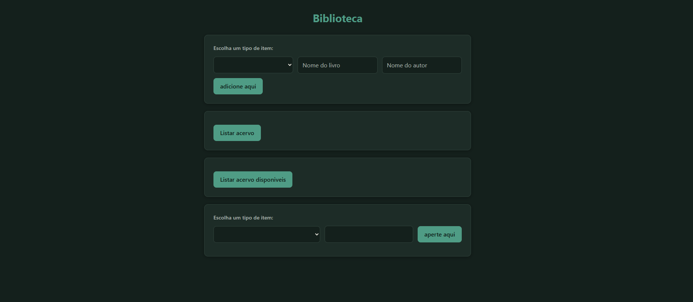

# Sistema de Biblioteca — POO em JavaScript

Sistema simples de acervo de biblioteca, feito para praticar **programação orientada a objetos** e **módulos ES** em JavaScript puro. O acervo guarda livros e revistas, controla quais estão disponíveis ou emprestados e permite cadastrar, listar, buscar, emprestar e devolver itens por uma interface HTML.

> Projeto de estudos, sem frameworks nem bibliotecas externas.



## Funcionalidades

- **Cadastrar itens**: escolha o tipo (livro ou revista), informe o título e o autor (ou a edição) e adicione ao acervo
- **Listar acervo**: mostra todos os itens com título, autor ou edição e disponibilidade
- **Listar disponíveis**: mostra apenas os itens que não estão emprestados
- **Buscar por título**: procura um item pelo título, sem diferenciar maiúsculas de minúsculas
- **Emprestar e devolver**: escolha a ação, busque o título e use o botão que aparece no resultado. Só são mostrados os itens que podem receber aquela ação (disponíveis para emprestar, emprestados para devolver)
- Acervo de exemplo criado automaticamente: 4 livros e 2 revistas, com os dois primeiros livros já emprestados
- Interface com tema claro e escuro (conforme o sistema do usuário) e layout responsivo

## Conceitos praticados

| Conceito | Onde aparece |
|----------|--------------|
| **Herança** | `livro` e `revista` estendem a classe `item` |
| **Encapsulamento** | campo privado `#disponivel` em `item`, acessado só por métodos e por um *getter* |
| **Polimorfismo** | cada subclasse tem o seu próprio método `descricao()` |
| **Membro estático** | `item.TotalDeItens` conta quantos itens foram criados |
| **Closure** | `criarBuscador(acervo)` retorna uma função que "lembra" o acervo; os botões de emprestar e devolver "lembram" o item encontrado na busca |
| **Módulos (`import`/`export`)** | cada classe em seu arquivo, importadas por `main.js` |
| **DOM e eventos** | criação de itens de lista e botões, leitura dos campos no momento do clique |
| **Laços e arrays** | `for`, `while`, `forEach` e `for...of` sobre o acervo |

## Estrutura do projeto

```
├── item.js          # classe base item (título, disponibilidade, emprestar/devolver)
├── livro.js         # classe livro, que estende item
├── revista.js       # classe revista, que estende item
├── buscador.js      # função criarBuscador (closure)
├── main.js          # cria o acervo e liga a interface (DOM e eventos)
├── exercicio.html   # página do projeto
└── style.css        # estilos da interface
```

## Como rodar

Como o projeto usa módulos ES (`import`/`export`), o navegador **não executa** o arquivo se você apenas der dois cliques no HTML. É preciso abrir por um servidor local:

**Opção 1: extensão Live Server (VS Code)**

1. Instale a extensão **Live Server**.
2. Clique com o botão direito em `exercicio.html` e escolha **Open with Live Server**.

**Opção 2: pelo terminal** (na pasta do projeto)

```bash
npx serve
```

ou, se tiver Python instalado:

```bash
python -m http.server 8000
```

Depois, abra o endereço mostrado no terminal e acesse `exercicio.html`.

## Próximos passos

- Validar campos vazios antes de cadastrar e avisar o usuário quando um item não for encontrado ou estiver indisponível
- Limpar os resultados anteriores a cada nova listagem ou busca
- Salvar o acervo no navegador (`localStorage`) para os dados não se perderem ao recarregar
- Adicionar testes automatizados e publicar a página online com GitHub Pages
